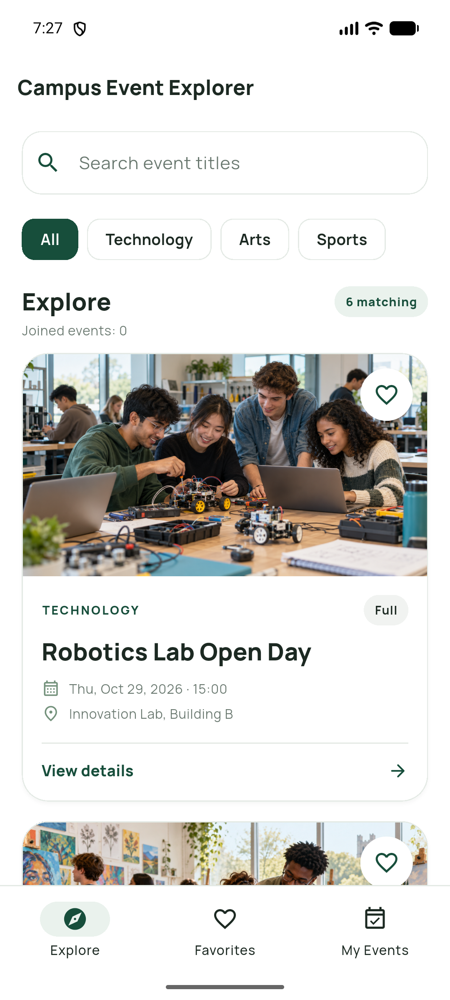
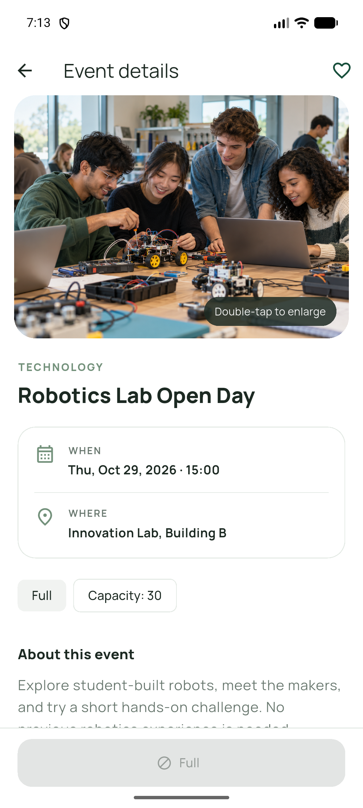
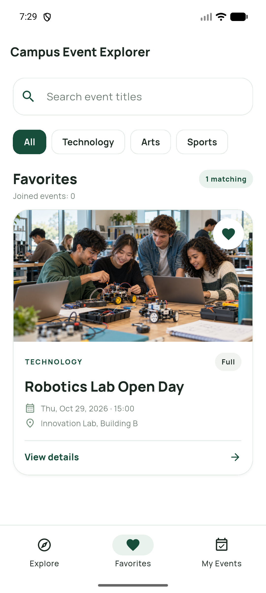
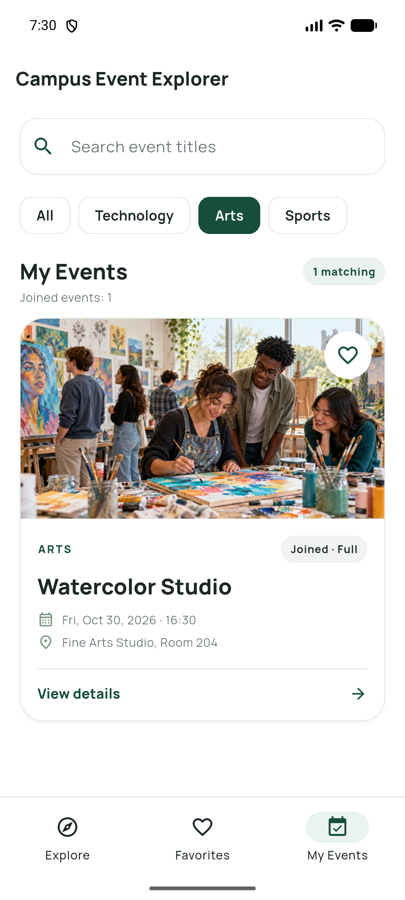

# Campus Event Explorer

BIM493 Mobile Programming I - Assignment 1 (2026-2027)

An offline Flutter app for discovering fictional campus events, saving favorites, and managing participation. All event data and session state stay on the device. Favorites and joined events reset when the app restarts, as allowed by the assignment.

## Team

| Student | Full name | Student ID | Share |
| --- | --- | --- | --- |
| 1 | Ömer Kağan Kaplan | 32290675712 | 50% |
| 2 | Emre Kechagia | 99687716014 | 50% |

### Ömer Kağan Kaplan

- Implemented the event data and the Explore event list.
- Developed title search, category filtering, and empty-result states.
- Implemented Favorites and My Events behavior, including join, cancel, and capacity rules.
- Developed event details and navigation between the app's main screens.

### Emre Kechagia

- Designed the screen layouts and refined the visual style.
- Selected and prepared distinct event images for the app.
- Tested the main user flows and checked edge cases.
- Prepared the screenshots and project documentation for submission.

## Required environment

- Flutter **3.47.6**, **Stable** channel
- Android SDK and an Android emulator or physical Android device

Output of `flutter --version` used for this project:

```text
Flutter 3.47.6 • channel stable • https://github.com/flutter/flutter.git
Framework • revision 5fc346839b (3 weeks ago) • 2026-09-30 15:02:49 -0700
Engine • hash b8c8d3d8d5d0095127057f8a29ca8cc53da2167c (revision 692136cb65) (24 days ago)
Tools • Dart 3.13.5 • DevTools 2.60.0
```

Verify your own environment with `flutter --version` before running the project. On this development machine, Flutter 3.47.6 was installed separately from another Flutter version, so the full path to the 3.47.6 executable was used during development.

## Setup and run

```sh
flutter pub get
flutter devices
flutter run -d <android-device-id>
```

To run the automated checks:

```sh
flutter analyze
flutter test
```

## Features

- Six events in Technology, Arts, and Sports, each with a distinct local image, including a full event and an event with one initial place.
- Shared title search and category filter across Explore, Favorites, and My Events.
- Event details and a separate image viewer opened by double-tapping the detail image.
- Session-only favorites and participation, with confirmation dialogs and capacity updates.
- Empty states, current match count, and total joined-event count.

## Screenshots

These images were captured from the Android emulator running the app:

| Explore | Event details |
| --- | --- |
|  |  |

| Favorites | My Events |
| --- | --- |
|  |  |

The [cancel confirmation screenshot](screenshots/05-cancel-dialog.png) shows that a student who joined the final place can still cancel.

The [scrolled Explore screenshot](screenshots/06-explore-scrolled.png) shows that search, filters, and counts scroll away while the compact app title stays visible.

## Verification checklist

- [x] Full event starts with zero places and cannot be joined (widget and UI logic).
- [x] Last available place can be joined and participation can then be cancelled (widget test).
- [x] Cancel participation requires confirmation (widget test).
- [x] Empty search result shows a readable message (widget test).
- [x] Search and category filter combine across all three views (widget test).
- [x] Favorites update across views in the same session (widget test).

## Asset credits and licenses

- All six files in `assets/images/`: original AI-generated images created for this project with OpenAI image generation on October 24, 2026. Each event has its own locally bundled image; no third-party image source is used.
- `assets/fonts/Manrope.ttf`: Manrope by Mikhail Sharanda and contributors, from the [Google Fonts repository](https://github.com/google/fonts/tree/main/ofl/manrope). Licensed under the SIL Open Font License 1.1; the license is included at `assets/fonts/OFL.txt`.

## Known limitations

- Favorites and participation are kept only for the current app session and reset on restart.
- Event data is fictional and compiled into the app. There is no backend or real booking system.
